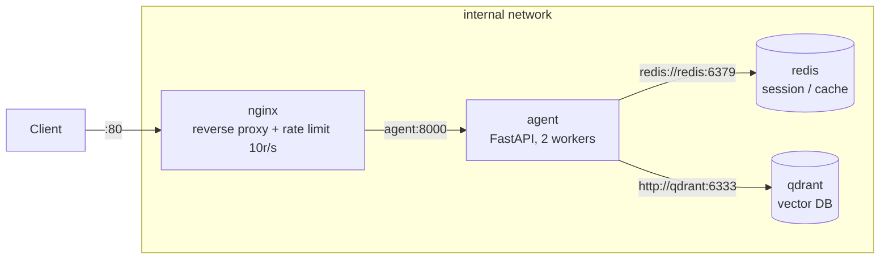

# Day 14 Lab — Mission Answers

> Môi trường chạy: Windows 11, Python 3.13 (venv), Docker Desktop 29.9 (engine Linux/WSL2).
> Mọi output dưới đây là output thật của các lệnh đã chạy ngày 2026-11-26. Token/secret đã che.

---

## Part 1: Localhost vs Production

### Exercise 1.1: Anti-patterns trong `01-localhost-vs-production/develop/app.py`

| # | Anti-pattern | Dòng | Vì sao nguy hiểm |
|---|---|---|---|
| 1 | Hardcode secret: `OPENAI_API_KEY = "sk-hardcoded-..."`, `DATABASE_URL` chứa `password123` | 17–18 | Push lên GitHub là lộ key; muốn đổi key phải sửa code và deploy lại |
| 2 | **Log ra secret**: `print(f"[DEBUG] Using key: {OPENAI_API_KEY}")` | 34 | Key nằm trong log — ai đọc được log (dashboard, log aggregator) là có key |
| 3 | `print()` thay cho logging có cấu trúc, log cả nội dung câu hỏi/câu trả lời | 33, 38 | Không có level, timestamp, không parse được; lộ dữ liệu người dùng |
| 4 | Không có `/health` (và `/ready`) | — | Platform không biết app đã chết để restart, LB không biết để ngừng route |
| 5 | Bind `host="localhost"` | 51 | Trong container chỉ nhận kết nối từ chính container → bên ngoài không gọi được |
| 6 | Port cứng `port=8000` | 52 | Railway/Render cấp port qua biến `PORT`; port cứng → health check fail |
| 7 | `reload=True` và `DEBUG = True` cứng | 21, 53 | Reloader tốn tài nguyên, theo dõi file, không dành cho production |
| 8 | Không có config management (`MAX_TOKENS` cứng) | 22 | Muốn đổi cấu hình giữa dev/staging/prod phải sửa code |
| 9 | Không xử lý graceful shutdown | — | Khi platform gửi SIGTERM, request đang chạy có thể bị cắt |

### Exercise 1.2: Chạy bản develop

Bản develop nhận `question` qua query (gửi JSON bị 422):

```text
$ curl -i -X POST http://localhost:8000/ask -H "Content-Type: application/json" -d '{"question":"Hello"}'
HTTP/1.1 422 Unprocessable Content

$ curl -i -X POST "http://localhost:8000/ask?question=Hello"
HTTP/1.1 200 OK
{"answer":"Tôi là AI agent được deploy lên cloud. Câu hỏi của bạn đã được nhận."}

$ curl -i http://localhost:8000/health
HTTP/1.1 404 Not Found
```

Log server — **secret bị in ra log**:

```text
[DEBUG] Got question: Hello
[DEBUG] Using key: sk-hardcoded-fake-key-never-do-this
[DEBUG] Response: Tôi là AI agent được deploy lên cloud. ...
```

→ Nó chạy, nhưng không production-ready: không health check, lộ secret, chỉ nghe trên localhost.

### Exercise 1.3: So sánh develop vs production

Bản production (`cp .env.example .env`, `python app.py`): `/ask` nhận JSON → 200, `/health` → `{"status":"ok","uptime_seconds":3.9,...}`, `/ready` → `{"ready":true}`.

| Feature | Develop | Production | Tại sao quan trọng? |
|---|---|---|---|
| Config | Hardcode trong code (`DEBUG=True`, key, port) | `config.py` đọc env (`os.getenv`), có `validate()` fail-fast khi thiếu `AGENT_API_KEY` ở production | Cùng một image chạy được ở dev/staging/prod; đổi cấu hình không cần build lại; secret không nằm trong git |
| Secrets | `sk-...` và `password123` trong code, còn in ra log | Đọc từ env, không log secret (chỉ log `question_length`) | Lộ repo/log không lộ key |
| Health check | Không có (404) | `/health` (liveness) + `/ready` (readiness) | Platform tự restart khi chết, LB chỉ gửi traffic khi sẵn sàng |
| Logging | `print()` | Log dạng JSON (`{"time":..,"level":..,"msg":..}`) | Log aggregator (Loki, Datadog) lọc/tìm theo field được |
| Shutdown | Đột ngột | `lifespan` dọn dẹp + handler SIGTERM, uvicorn chờ request đang chạy | Deploy/scale-down không làm mất request của người dùng |
| Host/Port | `localhost:8000` cứng | `0.0.0.0` + `PORT` từ env | Chạy được trong container và trên cloud |
| Reload/Debug | `reload=True` luôn bật | Chỉ bật khi `DEBUG=true` | Production không cần reloader |
| CORS | Không có | `ALLOWED_ORIGINS` từ env | Chỉ frontend được phép mới gọi được từ trình duyệt |

**Quan sát thêm:** khi chạy bản production, log JSON của app *không* xuất hiện — chỉ thấy `WARNING:root:OPENAI_API_KEY not set`. Lý do: `config.py` gọi `logging.warning()` lúc import, việc này tự cấu hình root logger với format mặc định; lệnh `logging.basicConfig(format=...)` trong `app.py` chạy sau nên bị bỏ qua (basicConfig chỉ có tác dụng lần đầu). Ở Part 6 tôi tránh lỗi này bằng `basicConfig(..., force=True)`.

---

## Part 2: Docker

### Exercise 2.1: Câu hỏi về `02-docker/develop/Dockerfile`

1. **Base image:** `python:3.11` — bản Debian đầy đủ (có compiler, header, nhiều tool) nên rất nặng.
2. **Working directory:** `/app` (`WORKDIR /app`), mọi lệnh COPY/RUN/CMD sau đó chạy ở đây.
3. **Vì sao COPY `requirements.txt` trước:** Docker cache theo từng layer. Nếu copy requirements và `pip install` trước, khi chỉ sửa code thì layer cài thư viện vẫn dùng cache, build chỉ mất vài giây. Nếu `COPY . .` trước thì mỗi lần sửa 1 dòng code cache bị vỡ và phải cài lại toàn bộ thư viện.
4. **CMD vs ENTRYPOINT:** `ENTRYPOINT` là lệnh chính cố định của container; `CMD` là lệnh/tham số mặc định, bị ghi đè khi `docker run image <lệnh khác>`. Khi có cả hai, CMD trở thành tham số cho ENTRYPOINT. Ở đây chỉ có `CMD ["python", "app.py"]` (exec form → python là PID 1, nhận được SIGTERM).

### Exercise 2.2: Build và chạy

```text
$ docker build -f 02-docker/develop/Dockerfile -t my-agent:develop .
$ docker run -p 8000:8000 my-agent:develop
$ curl -i -X POST "http://localhost:8000/ask?question=What%20is%20Docker%3F"
HTTP/1.1 200 OK
{"answer":"Container là cách đóng gói app để chạy ở mọi nơi. Build once, run anywhere!"}
$ curl http://localhost:8000/health
{"status":"ok","uptime_seconds":4.1,"container":true}
```

### Exercise 2.3: Multi-stage build và kích thước image

- **Stage 1 (builder):** `python:3.11-slim` + cài `gcc`, `libpq-dev`, rồi `pip install --user` các thư viện vào `/root/.local`. Stage này có đủ công cụ build nhưng **không được deploy**.
- **Stage 2 (runtime):** `python:3.11-slim` sạch, tạo user non-root `appuser`, chỉ `COPY --from=builder` thư mục site-packages và source code, có `HEALTHCHECK`.
- **Vì sao nhỏ hơn:** image cuối không chứa compiler, apt cache, pip cache, header file; base là `slim` thay vì bản full.

```text
$ docker images my-agent
IMAGE               ID             DISK USAGE   CONTENT SIZE
my-agent:advanced   80eaefaf6b37        240MB         57.4MB
my-agent:develop    4838da3d0c9c       1.67GB          426MB

$ docker image inspect -f '{{.RepoTags}} {{.Size}}' my-agent:develop my-agent:advanced
[my-agent:develop] 1667779965
[my-agent:advanced] 239815425
```

- Develop: **1667.8 MB** (1,667,779,965 bytes)
- Production: **239.8 MB** (239,815,425 bytes)
- Chênh lệch: production nhỏ hơn **85.6%** (= 1 − 239.8 / 1667.8)

### Exercise 2.4: Docker Compose stack



Service được start: `redis`, `qdrant` (chạy trước, có healthcheck), `agent` (chờ redis + qdrant `service_healthy`), `nginx` (mở cổng 80/443). Chỉ Nginx publish port ra ngoài; các service nói chuyện với nhau qua network `internal` bằng **tên service** (Docker DNS), agent không mở port trực tiếp.

```text
$ docker compose -p k5-day14-docker up -d --build
SERVICE   STATUS                    PORTS
agent     Up 9 seconds (healthy)    8000/tcp
nginx     Up 8 seconds              0.0.0.0:80->80/tcp, 0.0.0.0:443->443/tcp
qdrant    Up 19 seconds (healthy)   6333-6334/tcp
redis     Up 19 seconds (healthy)   6379/tcp

$ curl -i http://localhost/health
HTTP/1.1 200 OK
{"status":"ok","uptime_seconds":7.9,"version":"2.0.0","timestamp":"2026-11-26T04:04:04.704701"}

$ curl -i http://localhost/ask -X POST -H "Content-Type: application/json" -d '{"question": "Explain microservices"}'
HTTP/1.1 200 OK
{"answer":"Đây là câu trả lời từ AI agent (mock). Trong production, đây sẽ là response từ OpenAI/Anthropic."}
```

---

## Part 3: Cloud Deployment

### Exercise 3.1 / 3.2: Deploy agent Part 6

- **URL public:** _(điền sau khi deploy — xem `DEPLOYMENT.md`)_
- Thư mục deploy: `06-lab-complete/` (dùng `railway.toml` / `render.yaml` viết ở Part 6).
- Biến môi trường đặt trên nền tảng: `AGENT_API_KEY` (secret), `REDIS_URL` (trỏ tới Redis của nền tảng), `ENVIRONMENT=production`, `RATE_LIMIT_PER_MINUTE`, `DAILY_BUDGET_USD`, `MONTHLY_BUDGET_USD`. `PORT` do nền tảng tự cấp.
- Ảnh: `screenshots/dashboard.png`, `screenshots/running.png`, `screenshots/test.png`.

### So sánh `railway.toml` và `render.yaml`

| | `railway.toml` | `render.yaml` (Blueprint) |
|---|---|---|
| Định dạng | TOML, cấu hình **một service** | YAML, mô tả **cả hạ tầng** (nhiều service: web + Redis/Key Value) |
| Build | `[build] builder = "DOCKERFILE"` | `runtime: docker`, `rootDir`, `dockerfilePath` |
| Health check | `[deploy] healthcheckPath = "/health"` | `healthCheckPath: /health` |
| Restart | `restartPolicyType = "ON_FAILURE"` | Render tự restart khi health check fail |
| Secret | **Không** nằm trong file — đặt bằng `railway variables set` / tab Variables | Khai báo trong file nhưng không ghi giá trị: `generateValue: true` (Render tự sinh) hoặc `sync: false` (nhập tay trên dashboard) |
| Redis | Tạo riêng trong project rồi tham chiếu biến `REDIS_URL` | Khai báo luôn service `keyvalue` và nối bằng `fromService ... property: connectionString` |
| Cách deploy | CLI `railway up` đẩy code từ máy | Đọc file từ repo GitHub, tự deploy lại mỗi lần push |

**Vì sao khác:** Railway thiên về "deploy nhanh từ CLI", phần hạ tầng (Redis, biến) cấu hình trên dashboard; Render theo hướng Infrastructure-as-Code — cả web service, Redis lẫn cách sinh secret đều nằm trong `render.yaml` nên dựng lại môi trường giống hệt chỉ bằng file trong repo.

### Exercise 3.3: Pipeline Cloud Run (`cloudbuild.yaml` + `service.yaml`)

1. **test** — chạy trong `python:3.11-slim`: cài requirements + pytest, chạy `pytest tests/`; test fail thì pipeline dừng.
2. **build** — `docker build` gắn 2 tag `ai-agent:$COMMIT_SHA` và `:latest`, dùng `--cache-from :latest` để tận dụng layer cache.
3. **push** — đẩy cả 2 tag lên Container Registry (`gcr.io/$PROJECT_ID/ai-agent`).
4. **deploy** — `gcloud run deploy` image theo đúng `$COMMIT_SHA` (truy vết được phiên bản) ở `asia-southeast1`, min 1 / max 10 instance, 512Mi, 1 CPU, secret lấy từ **Secret Manager** (`--set-secrets`), không ghi trong code.
5. `service.yaml` mô tả cùng service theo kiểu khai báo (Knative): `containerConcurrency: 80`, autoscale theo target 80 request đồng thời, `livenessProbe` → `/health`, `startupProbe` → `/ready`, `AGENT_API_KEY` lấy từ `secretKeyRef`.

---

## Part 4: API Security

### Exercise 4.1: API key (bản develop, `AGENT_API_KEY=secret-key-123 python app.py`)

- **Key được check ở đâu:** dependency `verify_api_key()` dùng `APIKeyHeader(name="X-API-Key", auto_error=False)`, gắn vào `/ask` bằng `Depends(verify_api_key)`.
- **Sai key:** thiếu header → **401**; có header nhưng sai → **403** (bản mẫu). Ở Part 6 tôi trả 401 cho cả hai trường hợp theo hợp đồng.
- **Rotate key:** key đọc từ env `AGENT_API_KEY` → đổi giá trị biến trên nền tảng rồi restart/redeploy, không sửa code. Muốn không downtime thì cho phép tạm thời 2 key (cũ + mới) trong thời gian chuyển.

```text
$ curl -i http://localhost:8000/ask -X POST -H "Content-Type: application/json" -d '{"question": "Hello"}'
HTTP/1.1 401 Unauthorized
{"detail":"Missing API key. Include header: X-API-Key: <your-key>"}

$ curl -i http://localhost:8000/ask -X POST -H "X-API-Key: wrong" -H "Content-Type: application/json" -d '{"question": "Hello"}'
HTTP/1.1 403 Forbidden
{"detail":"Invalid API key."}

$ curl -i http://localhost:8000/ask -X POST -H "X-API-Key: ***" -H "Content-Type: application/json" -d '{"question": "Hello"}'
HTTP/1.1 200 OK
{"question":"Hello","answer":"Agent đang hoạt động tốt! (mock response) Hỏi thêm câu hỏi đi nhé."}
```

### Exercise 4.2: JWT (bản production)

Flow: `POST /auth/token` với username/password → server ký JWT (HS256, payload `sub`, `role`, `iat`, `exp` 60 phút) → client gửi `Authorization: Bearer <token>` → `verify_token()` kiểm chữ ký + hạn, lấy `username`/`role` mà không cần tra DB.

```text
$ curl -i -X POST http://localhost:8000/auth/token -H "Content-Type: application/json" -d '{"username": "student", "password": "demo123"}'
HTTP/1.1 200 OK
{"access_token":"eyJ***REDACTED***","token_type":"bearer","expires_in_minutes":60,...}

$ curl -i http://localhost:8000/ask -X POST -H "Content-Type: application/json" -d '{"question": "Explain JWT"}'
HTTP/1.1 401 Unauthorized
www-authenticate: Bearer
{"detail":"Authentication required. Include: Authorization: Bearer <token>"}

$ curl -i http://localhost:8000/ask -X POST -H "Authorization: Bearer $TOKEN" -H "Content-Type: application/json" -d '{"question": "Explain JWT"}'
HTTP/1.1 200 OK
{"question":"Explain JWT","answer":"...","usage":{"requests_remaining":9,"budget_remaining_usd":1.6e-05}}
```

### Exercise 4.3: Rate limiting

- **Algorithm:** sliding window — mỗi user một `deque` timestamp, xoá timestamp cũ hơn 60s rồi đếm.
- **Limit:** user thường 10 req/phút (`rate_limiter_user`), admin 100 req/phút (`rate_limiter_admin`).
- **Bypass cho admin:** không bypass hẳn mà chọn limiter theo `role` trong JWT: `role == "admin"` → dùng limiter 100/phút (tài khoản `teacher`).
- **Hạn chế:** state nằm trong RAM của process → nhiều instance/worker thì mỗi cái đếm riêng, restart là mất. Part 6 chuyển sang Redis.

Vòng lặp 20 request bằng token của `student` (request đầu tiên ở 4.2 đã tính 1 lần):

```text
req  1 -> 200   req  6 -> 200   req 11 -> 429   req 16 -> 429
req  2 -> 200   req  7 -> 200   req 12 -> 429   req 17 -> 429
req  3 -> 200   req  8 -> 200   req 13 -> 429   req 18 -> 429
req  4 -> 200   req  9 -> 200   req 14 -> 429   req 19 -> 429
req  5 -> 200   req 10 -> 429   req 15 -> 429   req 20 -> 429

$ curl -i ... (request thứ 21)
HTTP/1.1 429 Too Many Requests
x-ratelimit-limit: 10
x-ratelimit-remaining: 0
retry-after: 54
{"detail":{"error":"Rate limit exceeded","limit":10,"window_seconds":60,"retry_after_seconds":54}}
```

### Exercise 4.4: Cost guard

Cách làm trong Part 6 (`06-lab-complete/app/cost_guard.py`):

1. **Tính chi phí theo token:** `cost = input_tokens/1000 × $0.00015 + output_tokens/1000 × $0.0006` (giá gpt-4o-mini).
2. **Lưu trong Redis, không trong RAM:** 2 key theo thời gian `cost:daily:YYYY-MM-DD` và `cost:monthly:YYYY-MM`, cộng dồn bằng `INCRBYFLOAT` (atomic — nhiều instance cộng cùng lúc không bị mất số), đặt `EXPIRE` 2 ngày / 32 ngày → **tự reset** khi sang ngày/tháng mới mà không cần cron.
3. **`check_budget()` gọi TRƯỚC khi gọi LLM:** `MGET` 2 key; nếu tổng ngày ≥ `DAILY_BUDGET_USD` hoặc tổng tháng ≥ `MONTHLY_BUDGET_USD` → **HTTP 402 Payment Required**, không tốn thêm tiền gọi LLM.
4. **`record_cost()` gọi SAU khi có câu trả lời:** cộng chi phí thật của request.
5. Redis lỗi → `check_budget` trả 503 (fail closed: không biết đã tiêu bao nhiêu thì không cho gọi tiếp).

**Rate limit vs cost guard:** rate limit bảo vệ *tốc độ* (một client không spam quá N req/phút), cost guard bảo vệ *tiền* (tổng chi phí của tất cả client). Cần cả hai vì 1000 client mỗi người gọi đúng giới hạn vẫn có thể đốt hết ngân sách, còn một prompt rất dài chỉ cần vài request đã tốn tiền.

---

## Part 5: Scaling & Reliability

### Exercise 5.1: Health checks (`05-scaling-reliability/develop`)

- `/health` (**liveness**): process còn sống không → trả 200 kèm uptime, version, kiểm tra memory bằng psutil. Fail → platform **restart** container.
- `/ready` (**readiness**): đã sẵn sàng nhận traffic chưa (`_is_ready` bật sau khi startup xong, tắt khi bắt đầu shutdown) → 503 khi chưa sẵn sàng. Fail → load balancer **ngừng gửi traffic** nhưng không restart.

```text
$ curl /health
{"status":"ok","uptime_seconds":1.6,"version":"1.0.0","environment":"development","timestamp":"...","checks":{"memory":{"status":"ok","used_percent":13.2}}}
$ curl /ready
{"ready":true,"in_flight_requests":1}
```

Vì sao tách riêng: nếu Redis chết mà `/health` cũng fail thì platform restart liên tục mọi instance (không giúp gì vì lỗi nằm ở Redis). Đúng ra chỉ `/ready` fail để LB tạm bỏ instance, còn process vẫn sống chờ Redis quay lại.

### Exercise 5.2: Graceful shutdown

Test trong Linux (container `python:3.11-slim`, vì Windows không gửi được SIGTERM): gửi `POST /ask` rồi `kill -TERM` ngay 0.05s sau.

```text
$ POST /ask (nền) rồi kill -TERM $PID ngay lập tức
request trả 200 sau 3.01 s: {"answer":"Agent đang hoạt động tốt! (mock response) ..."}
process exit code: 0
--- log ---
INFO:     Shutting down
INFO:     127.0.0.1:45982 - "POST /ask?question=Long%20task HTTP/1.1" 200 OK
INFO:     Waiting for application shutdown.
... INFO 🔄 Graceful shutdown initiated...
... INFO ✅ Shutdown complete
INFO:     Finished server process [7]
```

→ Request đang chạy **vẫn hoàn thành (200)** sau khi nhận SIGTERM, process thoát với exit code 0. Uvicorn ngừng nhận kết nối mới ("Shutting down"), chờ request in-flight, rồi chạy phần shutdown của `lifespan`.

### Exercise 5.3: Stateless design

`05-scaling-reliability/production/app.py` lưu session/history trong Redis (`session:<id>`, `SETEX` TTL 1 giờ, giữ 20 message gần nhất), không dùng dict trong RAM. Lý do: khi có 3 instance sau LB, request 1 có thể vào instance A, request 2 vào instance B — nếu history nằm trong RAM của A thì B không thấy. Đặt state ở Redis thì instance nào cũng đọc được, instance chết không mất dữ liệu.

### Exercise 5.4: Load balancing — `docker compose -p k5-day14-scaling up -d --build --scale agent=3`

```text
NAME                       STATUS                    PORTS
k5-day14-scaling-agent-1   Up 11 seconds (healthy)   8000/tcp
k5-day14-scaling-agent-2   Up 11 seconds (healthy)   8000/tcp
k5-day14-scaling-agent-3   Up 10 seconds (healthy)   8000/tcp
k5-day14-scaling-nginx-1   Up 10 seconds             0.0.0.0:8080->80/tcp
k5-day14-scaling-redis-1   Up 22 seconds (healthy)   6379/tcp
```

10 request `POST /chat`, đếm header `X-Served-By` mà Nginx gắn:

```text
      4 X-Served-By: 172.20.0.3:8000
      3 X-Served-By: 172.20.0.4:8000
      3 X-Served-By: 172.20.0.5:8000
```

→ Nginx chia round-robin gần đều cho 3 instance (Nginx `resolver 127.0.0.11` hỏi Docker DNS, tên `agent` trả về 3 IP).

### Exercise 5.5: `python test_stateless.py`

```text
Session ID: 55a33ff7-b321-4a1e-9842-17e2c192d027

Request 1: [instance-b8158d]  Q: What is Docker?
Request 2: [instance-b4a6c2]  Q: Why do we need containers?
Request 3: [instance-2a4abe]  Q: What is Kubernetes?
Request 4: [instance-b8158d]  Q: How does load balancing work?
Request 5: [instance-b4a6c2]  Q: What is Redis used for?
------------------------------------------------------------
Total requests: 5
Instances used: {'instance-b4a6c2', 'instance-2a4abe', 'instance-b8158d'}
✅ All requests served despite different instances!

--- Conversation History ---
Total messages: 10
✅ Session history preserved across all instances via Redis!
```

**Giải thích:** 5 câu hỏi cùng một `session_id` được 3 instance khác nhau phục vụ xen kẽ, nhưng history đọc lại vẫn đủ 10 message (5 user + 5 assistant) theo đúng thứ tự — vì mỗi instance đọc/ghi session ở Redis chung chứ không ở RAM riêng.

**Thí nghiệm thêm — tắt 1 instance giữa chừng:** tạo session, `docker stop k5-day14-scaling-agent-1`, gửi tiếp 4 request cùng session → `200 200 200 200`, history vẫn còn 10 message. Nginx (`proxy_next_upstream error timeout http_503`) chuyển traffic sang 2 instance còn lại, state không mất vì nằm trong Redis.

---

## Part 6: Final Project — `06-lab-complete/`

### Những gì đã làm

| File | Nội dung |
|---|---|
| `app/config.py` | Mọi cấu hình đọc từ env bằng `default_factory` (PORT, ENVIRONMENT, LOG_LEVEL, AGENT_API_KEY, REDIS_URL, RATE_LIMIT_PER_MINUTE, DAILY/MONTHLY_BUDGET_USD). Không có secret mặc định — thiếu key thì mọi `/ask` bị 401 |
| `app/auth.py` | `APIKeyHeader(auto_error=False)` + tự raise **401** khi thiếu/sai; so sánh bằng `hmac.compare_digest` (tránh timing attack) |
| `app/redis_client.py` | `redis.from_url(...)` không ping lúc import → app khởi động được khi Redis chưa có; timeout 2s; `redis_healthy()` cho `/ready` |
| `app/rate_limiter.py` | Sliding window bằng Redis sorted set (`ZREMRANGEBYSCORE → ZCARD → ZADD → EXPIRE`), key là hash của API key; vượt → **429** + `Retry-After` tính từ request cũ nhất |
| `app/cost_guard.py` | Xem Exercise 4.4 — **402** khi vượt budget ngày/tháng |
| `app/main.py` | `JsonFormatter` (mỗi dòng log 1 JSON), middleware log request + chặn stack trace (500 chung chung), `/health` (luôn 200), `/ready` (503 khi Redis chết), `/ask` = auth → rate limit → budget → LLM → record cost; `lifespan` + handler SIGTERM gọi lại handler cũ của uvicorn |
| `Dockerfile` | Multi-stage (`python:3.11-slim` builder cài vào `/opt/venv` → runtime chỉ copy venv + code), user non-root `app`, `HEALTHCHECK` bằng python, `CMD sh -c "exec uvicorn ... --port ${PORT:-8000} --workers 2"` → uvicorn là PID 1 |
| `docker-compose.yml` | `agent` (build, `env_file .env required:false`, `REDIS_URL=redis://redis:6379/0`, `depends_on redis: service_healthy`) + `redis:7-alpine` có healthcheck và volume |
| `.dockerignore` | `.env`, `.env.*` (giữ `.env.example`), `__pycache__`, `venv/.venv`, `.git`, docs, `benchmark-observability/` |
| `.env.example` | Liệt kê đủ biến, không có giá trị thật |
| `railway.toml` / `render.yaml` | builder DOCKERFILE + `healthcheckPath "/health"` / web docker + `healthCheckPath`, `AGENT_API_KEY: generateValue: true`, Redis bằng `keyvalue` + `fromService` |

Image cuối: **273 MB** (< 500 MB). `docker stop` tắt trong 1.2s với exit code 0.

### Vì sao `/health` 200 khi Redis chết nhưng `/ready` phải 503

`/health` trả lời câu hỏi "process còn sống không?" — Redis chết không phải lỗi của process, restart agent cũng không sửa được Redis, nên không được để platform restart vòng lặp. `/ready` trả lời "có nên gửi traffic vào không?" — không có Redis thì rate limit/cost guard không chạy được, nên báo 503 để LB tạm bỏ instance này cho tới khi Redis quay lại.

### Output `python check_production_ready.py`

Chạy đầy đủ (có Docker) trong môi trường Linux/POSIX (`os.name == posix`) — một container `python:3.11-slim` có Docker CLI, mount repo và Docker socket, `--network host`. Lý do: Python Windows không gửi được SIGTERM nên tiêu chí Graceful shutdown luôn ⚠️ (README lưu ý số 2). Trên Windows (11/12, chỉ thiếu bài test SIGTERM runtime) mọi mục khác đều ✅.

```text
================================================================
  📋 Checklist Deliverable
     ✅ Dockerfile (multi-stage, < 500 MB)
     ✅ docker-compose.yml (agent + redis)
     ✅ .dockerignore
     ✅ Health check endpoint (GET /health)
     ✅ Readiness endpoint (GET /ready)
     ✅ API Key authentication
     ✅ Rate limiting
     ✅ Cost guard
     ✅ Config từ environment variables
     ✅ Structured logging
     ✅ Graceful shutdown
     ✅ Public URL ready (Railway / Render config)
----------------------------------------------------------------
  Result: 12/12 tiêu chí đạt · 43/43 checks passed
  🎉 PASS 12/12 — PRODUCTION READY! Deploy nào!
================================================================
```

Một số dòng chi tiết đáng chú ý:

```text
✅ Docker: image < 500 MB — 273 MB
✅ Khi chạy: vượt giới hạn → 429 — 429 sau 5 request thành công (RATE_LIMIT_PER_MINUTE=5)
✅ Khi chạy: state nằm trong Redis — restart agent vẫn bị 429
✅ Khi chạy: Redis mất kết nối → /ready 503 (còn /health vẫn 200)
✅ Khi chạy: hết budget → 402 — 402 ở request thứ 1
✅ Khi chạy: SIGTERM lúc đang có request → request vẫn 200, process tự thoát — exit code 0
✅ Docker: `docker stop` tắt êm (exit code 0, < 10s) — exit code 0, 1.2s
```

---

## AI log

| # | Hỏi AI gì | Nhận được gì | Tôi tự sửa / kiểm tra thế nào |
|---|---|---|---|
| 1 | Dùng Claude Code (Claude Opus 5.5) đọc đề, `CODE_LAB.md` và script chấm, rồi hướng dẫn làm từng bước Part 6 | Code cho 6 file trong `app/`, Dockerfile multi-stage, compose, `.dockerignore`, `.env.example`, `railway.toml`, `render.yaml` | Chạy `check_production_ready.py` trên Windows (11/12, chỉ thiếu SIGTERM) rồi chạy lại trong container Linux → PASS 12/12. Kiểm lại từng tiêu chí với mục "Script chấm dựa vào..." trong README |
| 2 | Vì sao uvicorn ≥0.29 vẫn thoát exit code 0 khi tự đăng ký handler SIGTERM | Đọc source `Server.capture_signals`: uvicorn cài handler trước khi chạy lifespan → trong lifespan `signal.getsignal` trả về handler của uvicorn, wrapper phải gọi lại handler đó | Bài test runtime SIGTERM + `docker stop` đều exit 0 |
| 3 | Chạy các ví dụ Part 1, 2, 4, 5 và ghi lại output | Lệnh chạy + output thật trong bài | Mọi số (MB, mã HTTP, số instance) là output của lệnh đã chạy trên máy, không chép từ README |
| 4 | Part 7: sửa `KNOWLEDGE_BASE`, sửa lỗi `No module named 'uvicorn'` của Dockerfile production Part 7, chạy load test/eval/Locust, chụp ảnh Grafana/Jaeger/Prometheus | Thêm 2 tài liệu (JWT, Kubernetes HPA), thêm `ENV PYTHONUSERBASE`, ảnh chụp bằng Chrome headless | Eval cuối 23/23 PASS không regression; số trong `BENCHMARK_REPORT.md` đối chiếu với JSON/CSV |
| 5 | Phát hiện `docker compose run locust` tự scale agent về `replicas: 2` | Chạy lại benchmark scaling với `--no-deps` | Kiểm qua Prometheus: lần scale_1 chỉ có 1 instance nhận traffic, scale_3 có 3 instance ~20 req/s mỗi cái |
